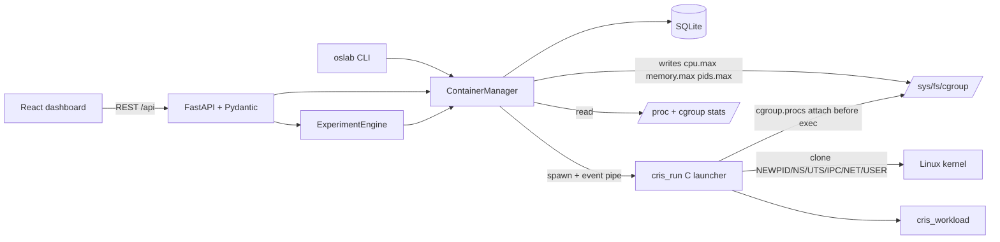
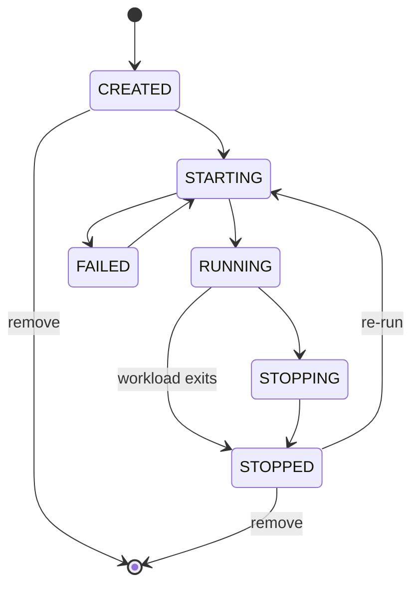

# Architecture

## Lifecycle

## Start sequence
1. Manager: `CREATED→STARTING` (atomic under lock ⇒ a duplicate start is a 409).
2. Spawn `cris_run` with an event pipe. It `clone()`s the child (child blocks on a sync pipe).
3. Parent writes uid/gid maps (user ns), then writes the child's PID to `cgroup.procs` — **limits apply before the workload executes**. Failure is fatal (exit 3), never silent.
4. Parent emits `started{host_pid}`; manager records pid + `/proc` starttime (PID-reuse safe) → `RUNNING`.
5. In a PID ns the child is PID 1: it mounts a private `/proc`, sets hostname, forks the workload and reaps orphans.
6. A supervisor thread samples cgroup (or `/proc`) stats every 0.5 s, then records exit, deltas of `cpu.stat`/`memory.events`, and the termination reason.

## Kill path
`SIGKILL` the ns init (kills the whole PID ns) + `cgroup.kill` (kernel ≥ 5.14) + `PDEATHSIG` on the init so a dead launcher cannot leave a namespace behind.
